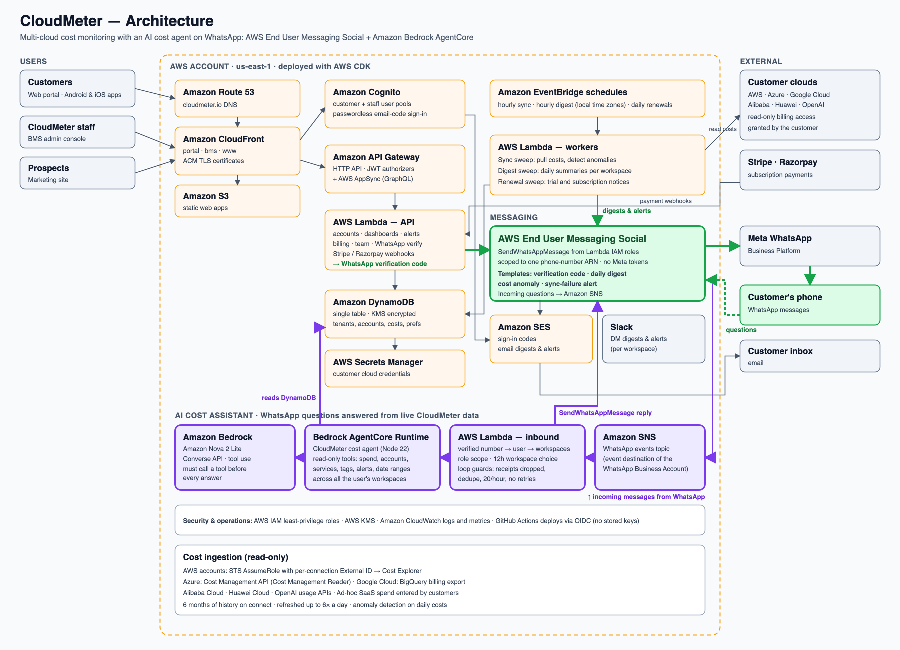

# CloudMeter Backend

CloudMeter is a multi-cloud cost-monitoring SaaS. It pulls billing data from a
customer's AWS, Azure, Google Cloud, Alibaba Cloud, Huawei Cloud and OpenAI
accounts (read-only), keeps one ledger across all of them, detects cost
anomalies, and tells people about them — on **WhatsApp through AWS End User
Messaging Social**, by email through Amazon SES, and on Slack.

Customers can also **ask CloudMeter about their costs on WhatsApp**. An AI agent
hosted on **Amazon Bedrock AgentCore**, using **Amazon Nova 2 Lite** on Amazon
Bedrock, reads their live CloudMeter data and replies in seconds — across every
workspace they belong to, and only the cloud accounts their role allows.

This repository is the whole backend: the AWS CDK app that defines every AWS
resource, and the Lambda functions that run CloudMeter. It is live at
[cloudmeter.io](https://cloudmeter.io) (customer portal:
[portal.cloudmeter.io](https://portal.cloudmeter.io)).



## Try it

**Web portal** — [portal.cloudmeter.io](https://portal.cloudmeter.io)

1. Enter `appreview@cloudmeter.io` and continue.
2. At the code screen enter `061628`. This login has a fixed code, so no mailbox
   is needed. It opens the **CloudMeter Demo** workspace: five sample cloud
   accounts (AWS, Azure, Google Cloud, OpenAI) with six months of history. No
   real cloud account is connected to it.

**WhatsApp AI cost assistant** — CloudMeter's number is **+91 81058 23737**.

1. Signed in as above, open **Notifications → Connect WhatsApp**, enter your
   mobile number and type in the code that arrives on WhatsApp. (The demo login
   holds one number at a time; verifying another number moves it.)
2. Message +91 81058 23737 from that phone, for example:
   - *How much did we spend this month?*
   - *Which cloud account costs the most?*
   - *s3 cost* · *lambda* · *Production (AWS)*
   - *Compare last week with the week before*
   - *Any cost spikes?*
   - *Delete my AWS account* — it explains it can only read.

A number that is not linked to a CloudMeter login gets a message saying how to
link it, and nothing else.

## The WhatsApp AI cost assistant

```
WhatsApp ─► AWS End User Messaging Social ─► Amazon SNS ─► Lambda whatsapp-inbound
                                                              │ who is asking (verified number → login)
                                                              │ which workspaces, which accounts
                                                              ▼
                                         Amazon Bedrock AgentCore Runtime — cost agent
                                                              │ Converse API with tool use
                                                              ▼
                                         Amazon Nova 2 Lite on Amazon Bedrock
                                                              │ read-only tools over DynamoDB
                                                              ▼
WhatsApp ◄─ AWS End User Messaging Social ◄─ SendWhatsAppMessage (reply)
```

| Part | Code |
|---|---|
| Inbound handler: parses End User Messaging events, finds the user from their verified number, decides the workspace, calls the agent, replies | [`functions/assistant/whatsapp-inbound`](functions/assistant/whatsapp-inbound/index.ts) |
| The agent served on AgentCore Runtime (`/invocations`, `/ping`), with the Bedrock Converse tool-use loop | [`functions/assistant/agent`](functions/assistant/agent/index.ts) |
| Read-only tools: spend summary, account lookup, service and tag costs, alerts, daily spend, all-workspace answers | [`functions/assistant/tools.ts`](functions/assistant/tools.ts) |
| Matching what people type to billed names (S3 → Amazon Simple Storage Service) | [`functions/assistant/names.ts`](functions/assistant/names.ts) |
| Which workspace a question is about | [`functions/assistant/workspace-choice.ts`](functions/assistant/workspace-choice.ts) |
| Infrastructure: SNS topic, Lambda, AgentCore runtime, IAM, alarm | [`lib/assistant-stack.ts`](lib/assistant-stack.ts) |

What it guarantees:

- **Only the asker's own data.** The workspaces come from the verified phone
  number's CloudMeter login, never from the message. A Member sees only the
  cloud accounts assigned to them. The agent's IAM role has read-only table
  access.
- **No invented figures.** The first model call must use a tool
  (`toolChoice: any`), totals are computed in the tools, and an unknown name
  returns the real list rather than a guess.
- **Many workspaces.** For someone in several workspaces, a question is answered
  for all of them, one line each, unless they name one. `switch to <name>` pins
  a workspace, `all` releases it.
- **Cannot loop.** Delivery receipts and our own number are dropped before
  anything runs, every message id is handled once, 20 questions an hour per
  number, no retries, reserved concurrency of 5, and a CloudWatch alarm on the
  invocation count.

## Where Amazon SES is used

Email is sent with the SES client (`@aws-sdk/client-ses`, `SendEmailCommand`):
passwordless sign-in codes
([`functions/auth/create-auth-challenge`](functions/auth/create-auth-challenge/index.ts)),
anomaly alerts ([`functions/shared/alert-notify.ts`](functions/shared/alert-notify.ts)),
daily digests ([`functions/shared/digest-email.ts`](functions/shared/digest-email.ts)),
renewal notices, team invitations and ownership changes.

## Where AWS End User Messaging Social is used

Every WhatsApp message CloudMeter sends goes through AWS End User Messaging
Social's `SendWhatsAppMessage` API, called from Lambda with the AWS SDK. No Meta
access token is stored or used on this path; the call is authorised by the
Lambda function's own IAM role.

**The call itself** — [`functions/shared/whatsapp.ts`](functions/shared/whatsapp.ts):

| Line | What happens |
|---|---|
| [2](functions/shared/whatsapp.ts#L2) | `import { SocialMessagingClient, SendWhatsAppMessageCommand } from '@aws-sdk/client-socialmessaging'` |
| [21–22](functions/shared/whatsapp.ts#L21-L22) | Reads the origination phone number id (`WHATSAPP_ORIGINATION_PHONE_ID`) and creates the client |
| [85](functions/shared/whatsapp.ts#L85) | `sendTemplate()` routes every send through AWS when that id is set |
| [136–167](functions/shared/whatsapp.ts#L136-L167) | `sendTemplateViaAws()` builds the WhatsApp template message and calls `SendWhatsAppMessageCommand`; throttling is marked retryable |
| [177](functions/shared/whatsapp.ts#L177) | `sendTextViaAws()` sends a free-text reply (inside the 24-hour window a customer opens) with the same command — used by the AI assistant |

**What calls it at runtime:**

| Caller | Message | Triggered by |
|---|---|---|
| [`functions/shared/alert-notify.ts`](functions/shared/alert-notify.ts) | `cloudmeter_cost_anomaly` — cost spike alert | The hourly sync sweep, when it detects an anomaly |
| [`functions/shared/digest-whatsapp.ts`](functions/shared/digest-whatsapp.ts) | `cloudmeter_daily_digest` — yesterday's spend summary | The hourly digest sweep, at each workspace's chosen local time |
| [`functions/api/notifications-whatsapp-start`](functions/api/notifications-whatsapp-start/index.ts) | `cloudmeter_verify_code` — one-time code to verify a phone number | A user connecting WhatsApp in the portal |
| [`functions/api/notifications-test-digest`](functions/api/notifications-test-digest/index.ts) | `cloudmeter_daily_digest` — a test digest | A user asking for a test digest in the portal |
| [`functions/assistant/whatsapp-inbound`](functions/assistant/whatsapp-inbound/index.ts) | Free-text AI answers | A customer messaging CloudMeter's number |

**Least-privilege IAM** — [`lib/notifications-stack.ts`](lib/notifications-stack.ts),
`allowAwsWhatsApp()`: each of those five functions gets the phone number id as
an environment variable and permission for `social-messaging:SendWhatsAppMessage`
on **that one phone-number ARN only**. It is applied to the sync and digest
sweeps in `lib/notifications-stack.ts` and to the verify and test-digest API
functions in `lib/api-stack.ts`, and to the inbound assistant in
`lib/assistant-stack.ts`.

The message templates are documented in
[`docs/whatsapp-templates.md`](docs/whatsapp-templates.md). They must be
approved on the WhatsApp Business Account that is linked to AWS End User
Messaging Social.

## What's in this repository

| Path | Contents |
|---|---|
| `bin/infra.ts` | CDK app entry point: which stacks exist in which account and environment |
| `lib/` | One file per stack (listed below) |
| `functions/api/` | Lambda handlers behind the HTTP API (accounts, dashboards, alerts, billing, team, notifications…) |
| `functions/appsync/` | Lambda resolvers for the GraphQL API |
| `functions/auth/` | Cognito custom-auth triggers for passwordless email sign-in |
| `functions/notifications/` | The digest and renewal sweeps |
| `functions/assistant/` | The WhatsApp AI cost assistant: inbound handler, AgentCore agent, tools |
| `functions/ingestion/` | The hourly cost sync sweep |
| `functions/shared/` | Shared logic: cost providers, anomaly detection, digests, WhatsApp/SES/Slack delivery, billing |
| `graphql/` | AppSync schema |
| `test/` | Jest unit tests |
| `docs/` | Architecture diagram and WhatsApp template notes |

### Stacks

Each environment gets its own copy, suffixed with the environment name (e.g.
`CloudMeterApiStackProd`). An account gets `dev` and `prod`; the production
account also carries `uat`.

| Stack | What it creates |
|---|---|
| `CloudMeterDataStack…` | DynamoDB single table (KMS-encrypted) and the raw-cost S3 archive |
| `CloudMeterAuthStack…` | Cognito user pool for customers, passwordless email-code sign-in |
| `CloudMeterBmsAuthStack…` | A separate Cognito user pool for CloudMeter staff (admin console) |
| `CloudMeterNotificationsStack…` | EventBridge schedules and the sync, digest and renewal sweep Lambdas; WhatsApp/SES/Slack delivery |
| `CloudMeterApiStack…` | API Gateway HTTP API with Cognito JWT authorizers, and its Lambda routes |
| `CloudMeterAppSyncStack…` | AppSync GraphQL API |
| `CloudMeterFrontendStack{Portal,Bms,Www}…` | S3 + CloudFront for the three web apps, with security headers |
| `CloudMeterRedirectStack…`, `CloudMeterCertStack…`, `CloudMeterDnsStack` | Domain, certificates and redirects — only built in the account that owns `cloudmeter.io` |
| `CloudMeterAssistantStack…` | WhatsApp AI assistant: SNS topic, inbound Lambda, Bedrock AgentCore runtime, runaway alarm |
| `CloudMeterCiDeployStack` | IAM roles GitHub Actions uses (via OIDC) to deploy the web apps |

### The web apps

The web apps are static sites deployed to the `FrontendStack` buckets. They sit
next to this folder in this repository:

- Customer portal — [`../portal`](../portal)
- Staff admin console (BMS) — [`../staff-console`](../staff-console)
- Marketing site — [`../marketing`](../marketing)

## Running it

### Prerequisites

- Node.js 24 and npm
- An AWS account and credentials for it (AWS CLI profile or SSO)
- AWS End User Messaging Social available in the target region (CloudMeter runs in `us-east-1`)

### Build and test

```bash
npm install
npm run build        # type-check
npm test             # 44 Jest suites, 592 tests, no AWS access needed
npx cdk synth        # synthesize CloudFormation templates
```

### Deploy

CDK reads the target account and region from the environment:

```bash
export CDK_DEFAULT_ACCOUNT=<your-account-id> CDK_DEFAULT_REGION=us-east-1
npx cdk bootstrap aws://$CDK_DEFAULT_ACCOUNT/$CDK_DEFAULT_REGION   # once per account
npx cdk deploy --all \
  -c otpFromEmail=no-reply@<your-domain> \
  -c portalUrl=https://<portal-url> \
  -c bmsUrl=https://<bms-url>
```

| Context value | Purpose |
|---|---|
| `otpFromEmail` | SES-verified address that sign-in codes are sent from |
| `portalUrl`, `bmsUrl` | Links used in emails and WhatsApp messages |
| `siteOrigins` | Comma-separated web-app origins allowed by the API's CORS settings |

In an account that does not own `cloudmeter.io`, the web apps are served on
their CloudFront hostnames and no DNS or certificate stacks are created.
Deployment is manual; this repository has no CI.

### Turning on WhatsApp through AWS End User Messaging Social

1. In the AWS End User Messaging Social console, link your WhatsApp Business
   Account and phone number to the AWS account. AWS gives the number an id of
   the form `phone-number-id-…`.
2. Create the four templates from [`docs/whatsapp-templates.md`](docs/whatsapp-templates.md)
   on that WhatsApp Business Account and wait for them to be approved.
3. Add the id to `WHATSAPP_AWS_PHONES` in `bin/infra.ts`, keyed by your account
   and environment, and deploy. The four functions above then receive
   `WHATSAPP_ORIGINATION_PHONE_ID` and permission to send from that number.
4. In the portal, go to **Notifications → Connect WhatsApp**, enter a phone
   number and enter the code that arrives. Alerts and daily digests are then
   delivered to that number.

Without step 3, `sendTemplate()` falls back to Meta's Cloud API using
credentials from the `cloudmeter/whatsapp…` secret in Secrets Manager.

### Turning on the WhatsApp AI assistant

1. Make sure the account can use the model in
   `lib/assistant-stack.ts` (`us.amazon.nova-2-lite-v1:0`) on Amazon Bedrock.
2. Add the environment to `ASSISTANT_ENVS` in `bin/infra.ts` and deploy
   `CloudMeterAssistantStack…`. Its outputs are the SNS topic ARN and the
   AgentCore runtime ARN.
3. Point the WhatsApp Business Account's events at the topic — this setting has
   no CloudFormation resource:

   ```bash
   aws socialmessaging put-whatsapp-business-account-event-destinations \
     --id <waba-id> --event-destinations eventDestinationArn=<topic-arn>
   ```

   One WhatsApp Business Account sends its events to one topic, so only one
   environment answers at a time.
4. For users who verified WhatsApp before the assistant existed, write the
   number lookup once: `npx tsx scripts/backfill-whatsapp-lookup.ts <env> --write`.

## Schedules

| Schedule | When (UTC) | What it does |
|---|---|---|
| Sync sweep | Every hour at :05 | Pulls new cost data for accounts due a refresh, detects anomalies, sends alerts |
| Digest sweep | Every hour at :30 | Sends the daily summary to workspaces whose chosen local time it is |
| Renewal sweep | Daily at 07:00 | Trial and subscription notices |

## Built before and during the hackathon

CloudMeter's first commit was on 17 August 2026. The AWS CDS Agentic AI
hackathon's Submission Period began on 14 September 2026.

**Before 14 September 2026:** the core platform — cost ingestion from AWS,
Azure, Google Cloud and others, the dashboard, rules-based anomaly detection,
email sign-in and email alerts through Amazon SES.

**During the Submission Period (14 September – 28 October 2026):**
- The WhatsApp AI cost assistant: inbound messages through AWS End User
  Messaging Social and Amazon SNS, the agent on Amazon Bedrock AgentCore
  Runtime with Amazon Nova on Amazon Bedrock, and its read-only tools
  (October 2026).
- WhatsApp delivery through AWS End User Messaging Social — alerts, daily
  digests and phone verification — instead of Meta's API (October 2026).
- Slack delivery, plan-based notification channels, Stripe and Razorpay
  payments, the staff admin console (BMS), the public marketing site, and the
  move to a production AWS account with dev, UAT and prod environments.

By commits: 97 of the backend's 187 commits up to 23 October were made in the
Submission Period, as were 186 of the customer portal's 306, 22 of the staff
console's 33 and all 11 of the marketing site's. This public repository is a
snapshot made for judging; the commit history is in Mobil80's private
repositories.

